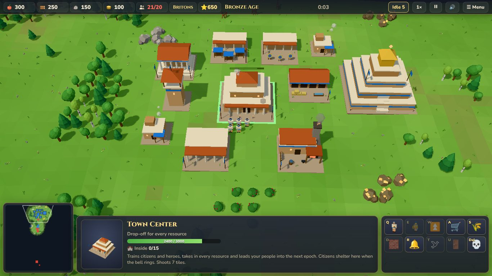
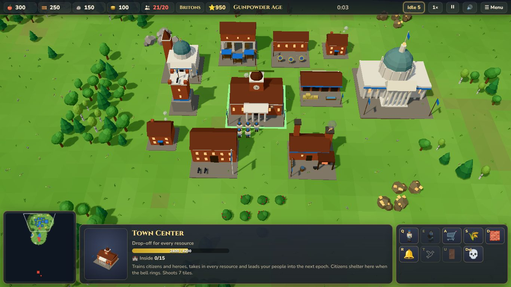
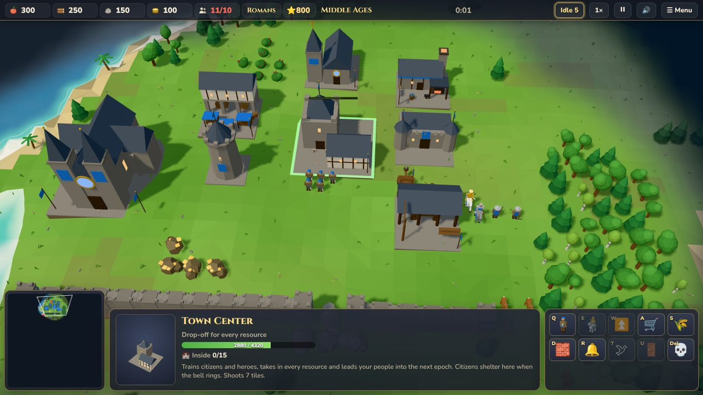
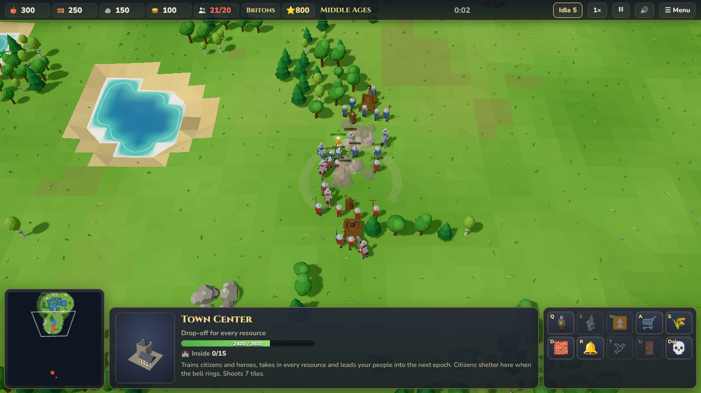
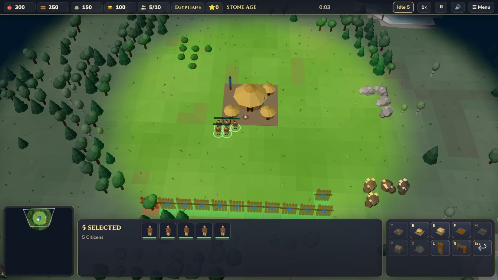
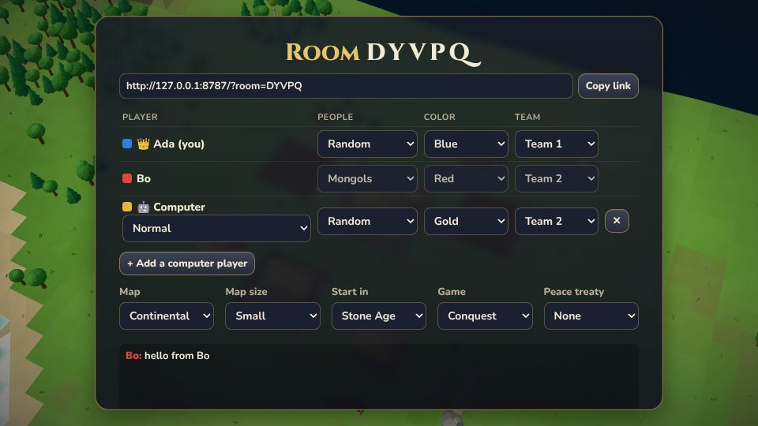
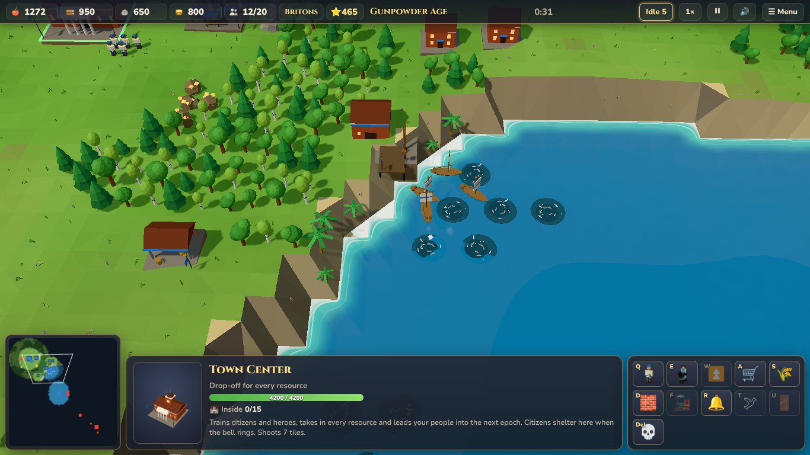
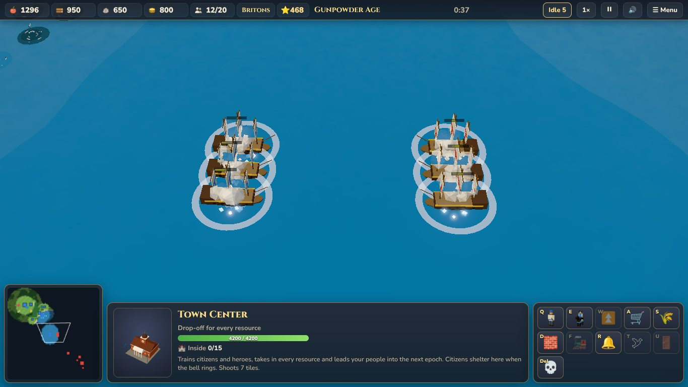
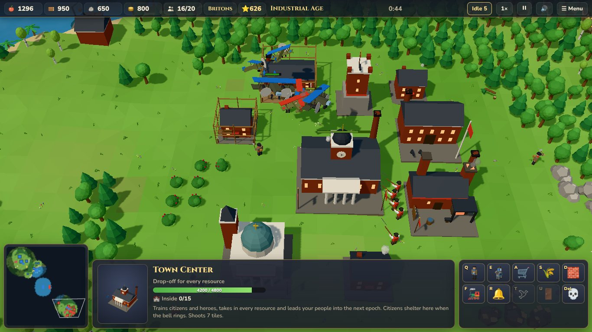
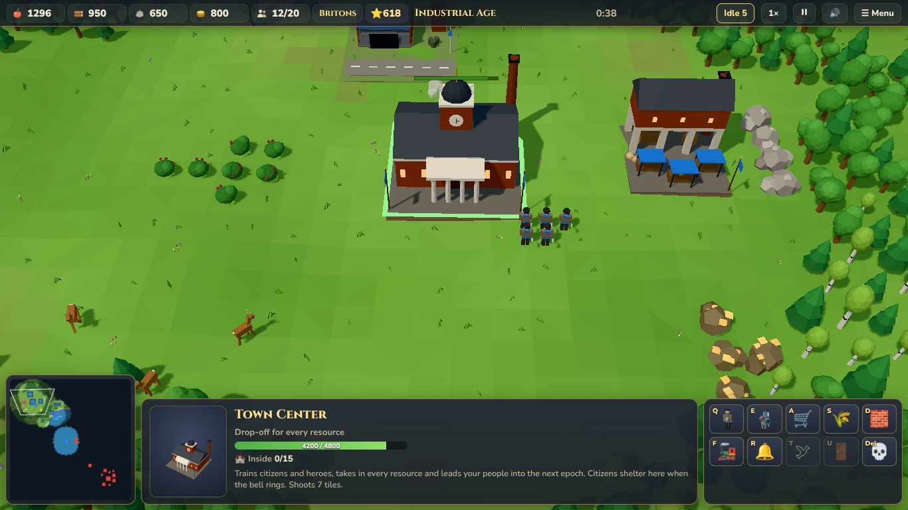

# Ages of Earth

A real-time strategy game in the browser, in the spirit of Empire Earth and Age of Empires: lead your people from the Stone Age through the Bronze Age, the Middle Ages and the Gunpowder Age to the Industrial Age, gather food, wood, stone and gold, fish the seas, build a town, raise an army and a navy, take to the air and conquer your rivals, alone against the computer or online with friends. It is built with TypeScript and Three.js, the same stack and low-poly look as Tideborn, and deploys the same way: a Cloudflare Worker serving static files, ready for a subdomain of your own domain.

What players love most about the classics, and where to find it here, is written up in [docs/design-notes.md](docs/design-notes.md).

| | |
|---|---|
|  |  |
|  |  |
|  |  |
|  |  |
|  |  |

## What's in it

- **Great works.** Once in each epoch from the Bronze Age, select a Town Center and press **V** to call your people's great work: free, for 90 seconds. Egyptians: the Nile Flood (farms +60%). Greeks: the Phalanx (foot +2 armor, +2 attack). Romans: the Roman Road (building 75% faster, citizens +25% speed). Mongols: the Yam Relay (cavalry +40% speed and +3 sight, citizens +15%). Chinese: the Grand Canal (trade pays +50%, traders +30% faster). Britons: the Longbow Volley (ranged +3 attack, ranges train twice as fast). Spend it on the boom or hold it for the battle; Hard and Expert computers time theirs (a farming or trading people while busy at it, a fighting one when a wave marches or a raid arrives). Its own horn-and-bells sound, and while it runs motes in the people's colors rise from its Town Centers, so you can see a rival's work is on; no save change.
- **Ways.** In the Stone Age, select a Town Center and pick a **Way**, a custom your people live by for the whole match: free, once. The **Hunters' Way** (hunting +30%, wolves, boars and mammoths bite 30% softer, citizens +5% quicker, berries −20%), the **Hearth Way** (berries +30%, farms +15%, wood +10%; hunting −20%, beasts bite 20% harder) or the **Warband Way** (soldiers train 15% faster and strike +1; berries and hunting −15%). Look at the deer and berries round your town and at how near your rival is. Leave the Stone Age without choosing and the moment is gone. Rivals are told which Way you took; a clever computer picks by the deer, berries and rival near its home; the choice shows on your people's chip at the top. **Vows (#338):** once, in the Bronze Age, a Town Center offers to **deepen** your Way (200 food + 100 wood: its gifts and its price both grow) or **turn** to another (100 food: the old custom is dropped). Pass it by and the Way stays; a clever computer deepens when it can pay with a stock to spare. No save change. **Way marks:** a people's Way shows at its Town Center (a pelt frame and stag skull, a stone-ringed fire, or a rack of spears and a red shield), so scouting a town tells you how it plays.  Each Way has its own sound when chosen.

- **Age of Aeronauts.** An Industrial people with a completed Airfield discovers a specific future at its Town Center: 600 food, 500 wood and 800 gold, 60 seconds. Fighters and bombers cost 25% less and take 25% less time to train; foot, ranged, cavalry and siege units cost 20% more. Combat strength stays Industrial, so riflemen, towers, ironclads and rival fighters remain answers. Sky blue bands and rooftop windsocks mark its towns, with its own synthesized theme. Return to Industrial for 200 food and 200 wood in 30 seconds, or Step Back as usual. Hard and Expert computers consider the road once they have aircraft, and leave if their completed airfields are lost. Its aircraft fly on fuel (sorties): rearmed and mended within 4 tiles of one of your Airfields, turned for home 30 tiles out and burning past 36, so a long reach needs a forward Airfield. Select one of your aircraft and the fuel bands show round your nearest Airfields: green where it is mended, amber where it turns home, red where it burns.
- **Age of Lightning** (#231). The other future out of the Industrial, the one history almost took (Tesla at Colorado Springs, Wardenclyffe): power is broadcast through the air from coils, not carried by coal and belts. A finished Watch Tower is the clue; the deed is the old way of sending word, your towers having lit 6 beacons (relays count); then 700 food, 450 stone and 1300 gold, 75 seconds (a hard gate). Every Watch Tower becomes a **Coil Tower** with a copper winding and a mushroom crown: buildings within 10 tiles of one train and research 35% faster, buildings outside every field 25% slower, so the town is laid out around its coils and a coil that falls darkens its quarter. A coil's bolt leaps from enemy to enemy (up to 4, 2.5 tiles a leap, 70% kept at each), the hardest on crowds. What it gives up: aircraft, since the air hums with current. A whole-tone theremin plays. Hard and Expert computers with towers and no aircraft light beacons toward it, take it, raise coils by dark workshops, and come back to the Industrial when their coils fall. A faint blue-white ring shows each finished coil's field (and the field a Watch Tower you are placing would add), and a building's panel says whether it is lit ("works 35% faster") or dark. Within 12 tiles of the view a coil hums, louder the nearer (synthesized, `coilHum`). The computer raids the coil whose fall would darken the most of a rival's buildings. `LIGHTNING`, `AI_LIGHTNING` in `data.ts`.

- **Signal beacons.** Select a finished Watch Tower and press **F** to light a fire on its roof (30 wood, 45 seconds, then two minutes before it can be lit again). The flame relays free to your other finished Watch Towers within 14 tiles, and on down a chain, for 25 seconds each: a line of towers carries the warning across your land, and shows rivals every one. The tower sees 7 tiles farther while it burns, but every rival sees the ground around it, so you trade a tower's hiding place for warning. A clever computer lights one when three rival soldiers close in on a tower, or when it sees a rival's beacon burning within 24 tiles of one: it answers your flame.
- **The Rallying Cry.** Select your hero and press **R**: every soldier of yours within 8 tiles is stirred for 12 seconds, striking 30% harder, taking 1 less damage a blow and mended 6 at once. The hero then needs 70 seconds to draw breath. It does nothing for a soldier who isn't fighting, so call it when the lines meet. A clever computer's hero cries out when four of its soldiers stand by it and two rivals are in reach. Stirred soldiers wear a gold ring while it lasts. Numbers in `RALLY` (`src/sim/data.ts`).
- **A hero's fall.** When a hero dies, yours or one you can see, two gold rings spread over the ground, embers rise and a low bell tolls twice. Look and sound only.
- **Hunters hunted.** On Hard and Expert, the computer falls on your citizens working far from home. When its soldiers see one of yours out in the open (butchering a far kill, digging a ruin, claiming a landmark, mining wild gold), more than 12 tiles from your Town Centers and Watch Towers, with no soldier of yours within 7 tiles and no more than two citizens per raider round them, it sends two or three idle soldiers at them between its waves, chases on to the next one near, and goes home the moment one of your soldiers comes, or after 45 seconds. Seeing no one, it walks a band out to a Hunting Camp of yours it has seen, to find who's butchering there, and if the camp stands empty it sets about the camp itself (45 seconds more) and goes home once it falls. So the far mammoth is a gamble: guard the hunt, hunt nearer home, or take the risk. Not on Easy or Normal, and never during a peace treaty. Numbers in `AI_PROWL` (`src/sim/data.ts`).
- **Signal beacons.** Select a finished Watch Tower and press **F** to light a fire on its roof (30 wood, 45 seconds, then two minutes before it can be lit again). The flame relays free to your other finished Watch Towers within 14 tiles, and on down a chain, for 25 seconds each: a line of towers carries the warning across your land, and shows rivals every one. The tower sees 7 tiles farther while it burns, but every rival sees the ground around it, so you trade a tower's hiding place for warning. A clever computer lights one when three rival soldiers close in on a tower.
- **Borders.** Every finished Town Center, Watch Tower, Wonder, Dock and Airfield claims the land around it (14 tiles for a Town Center); each tile goes to the nearest claimant. Your land and a rival's are drawn as thin coloured lines over the ground you have explored; **O** hides them. **Attrition:** a land soldier in an enemy's land with none of its own team's land within 9 tiles loses 2% of its health every 5 s (not during a peace treaty; ships, aircraft, citizens, priests and traders are exempt), so push out a Town Center or Tower as a foothold. The computer reads this: a wave worn under half health deep in your land, with no foe near, falls back to regroup (`AI_RAID`). **Building:** nothing may be raised in an enemy's land except a Watch Tower (the foothold); neutral and allied land are open. Numbers in `BORDERS` and `ATTRITION`.
- **Tactical Reach.** Hold **Alt** to show pale cyan firing guides for your selected ranged troops, siege, warships, aircraft and completed defenses, alongside all health bars. Dashed amber circles mark siege dead zones. Tower and Town Center placement previews show their future firing reach automatically, including researched range. Guides follow hills and water, stop at currently hidden ground, and show at most 24 selections (the placement preview gets priority). Unit guides measure reach to a target's near edge; target size and type still matter. Presentation only, with no combat, save or replay change.

- **Dust of the march.** Cavalry, chariots and siege engines at a hard pace kick up puffs of tan dust off dry ground, white powder off snow; rain keeps it down and mist halves it. Look only; off on Low quality.
- **Scout Flags.** Ctrl+right-click explored ground or the minimap to leave a small gold pennant and a persistent map triangle; add Shift for a red danger flag. Repeat on a flag to remove it or change its kind. Keep up to six; a seventh replaces the oldest. Mark ruins, ambush sites and safe roads without issuing orders. Flags are private to this browser's current match, never pierce fog or travel online, and reset between matches; saves and replays stay unchanged.
- **Waymarks.** The minimap remembers ruins and relics as you last saw them. A ruin you saw dug shows hollow, struck through and rimmed in the digger's colour; one you saw standing stays standing until a scout looks again; a relic out of sight sits dimmed where it was last seen. Send a scout back to check. Held in the browser, never in saves, replays or online play.
- **Camera bookmarks.** Remember up to four views in a match with **Ctrl+Shift+1–4**, and return to any with **Shift+1–4**. Glance from your town to a frontier fort, trading road or landing beach without changing selected troops, orders or ordinary 1–9 control groups. Views clear when a new match starts; they aren't part of saves or replays.
- **The hours of the day.** A match opens on a morning chosen from its seed, and the light drifts through noon, a golden afternoon, a red sunset and a blue night, one whole day for every hour of play (so a half-hour match runs from morning to dusk). Sun angle, shadows, sky, haze, the water's glint and the sun's colour all follow the hour; the weather greys it afterwards. It is drawn from the match's tick alone, so an online room, a save and a replay all share it; no rules or save change. Add `?hour=19.5` to the address to hold the clock still. **Moonlit nights:** each match keeps a moon phase from its seed, so a full-moon night is brighter than a crescent one, and on a clear night the lakes glint with the stars (cloud hides them). **Lit windows:** windows, torches and lanterns shine near twice as bright after dusk, so a town glows against the dark. **Fireflies:** on a clear night, green-gold sparks drift low over the land near the camera, each blinking at its own pace (off on Low quality, and in rain, snow or mist). **Bats:** at dusk and dawn, a few dark bats flit and jink over the land near the camera, wings beating (clear weather, not on Low quality). **Owls:** in the dead of a clear night, a few pale owls glide in slow circuits over the land near the camera on broad, slow wings, and now and then one hoots from the dark (not on Low quality). **Gulls:** by day, with open water near the view, a gull now and then cries from one side (clear weather). **Birdsong:** by day, away from open water and armies, a songbird whistles now and then from one side (clear weather). **Crickets:** on a clear night, away from open water, crickets chirp in the grass. **Frogs:** on a clear night, with open water near the view, frogs croak at the shore (crickets keep the dry meadow). **Owl perches:** in the dead of night an owl sits on each nearby standing ruin you have seen, blinking its eyes; a dug-out ruin goes quiet.
- **Weather.** Every match is played under a day chosen from its seed and its land, so everyone in an online room, a save and a replay see the same one: clear, **rain** (streaks, a grey sky, a hiss over the ambience, and in a storm lightning that lights the land and thunder that rolls in a moment later), **snow** (flakes drifting, a muffled hush) or **mist** (the horizon closes in). Highlands snow, forests rain, plains are mostly fair. The opening banner says what it is. It changes only how the land looks and sounds, never the rules: units see and shoot as far as on a clear day. Each match also has a **wind**, fixed by the seed (stronger in a storm): chimney, forge and battle smoke lean the same way across the land, and rain slants and snow drifts with it. **Banners** on buildings, the airfield's windsock, **masthead pennants on ships** and the pole banners of riders and siege engines stream downwind and ripple faster in a gale (they hang limp on a calm day). Low graphics draw no rain or snow. Add `?weather=rain` (or `snow`, `mist`, `clear`) to the address to try one.
- **Readable health bars.** Quarter marks make remaining health readable by shape as well as color; hold **Alt** to compare all health bars during a battle.

- **Five epochs.** Stone, Bronze, Middle Ages, Gunpowder and Industrial. Advancing costs food, wood, gold and stone and takes time at the Town Center. When you advance, every unit re-arms (clubman to spearman to pikeman to halberdier to bayonet-armed fusilier) and every building is rebuilt in the new style, keeping its share of health. The Industrial Age brings riflemen, hussars, field guns, a Field Marshal, red-brick towns with smokestacks, ironclads, paddle steamers and aircraft.
- **Deep veins.** Some worlds hold **rare ores** that others lack, by the seed's own dice: **salt**, **saltpetre** and **blood-iron**. Each lies in a few neutral veins out between the towns, clear of every home, where every town can walk. Citizens mine them like stone and bring them home to a separate store shown on the top bar; click a vein for what it is. Salt and blood-iron open roads (the Age of Merchants, Iron and Blood); saltpetre lets the Siege Workshop research **Black Powder** (ranged +1, siege +15%) once 40 are mined, and only in a world that holds it (#356).
- **Caves.** Where a world holds a rare ore, one or two caves (three on a large map) are cut into the ground between the towns: a single tile of the ore, three times a vein's worth, shown as a dark cave mouth. On medium and large maps about half are **dens** where a wolf pack lairs at the mouth, so the richest ore is the best guarded (#356).
- **Ore doors.** In a world that holds the ore, mining it opens a road in place of its deeds: **60 salt** opens the Age of Merchants (instead of 400 gold of trade), **50 blood-iron** opens Iron and Blood (instead of 600 plunder). The clue shows on the road once you have dug some; a world without the ore keeps the usual deeds, so a simple road always works. The computer still takes the usual deeds (it learns to mine in s5).
- **The computer digs the ore.** A clever town bound for the Merchants or Iron and Blood, in a world that holds the ore, sends `AI_ORE.crew` citizens to the nearest vein once it has a Storehouse, holds the road while they dig, and sends them back to work when the door opens or the road is given up. Without the ore it walks the deeds as before.
- **Ages as a web.** The five epochs are the main road, and it always works. Beside it, side ages branch off and rejoin it. The first is the **Age of Merchants**: once a Bronze Age people has a Market and its traders have brought home 400 gold, the Town Center (**Y**) can take it there instead of the Middle Ages. Same soldiers and technologies, but the Market **hires mercenaries** (foot, bow and horse) for gold alone in half the time, trade pays a quarter more, and soldiers trained the usual way cost a fifth more. Bog iron dug on any road (75 bars a step, to +40%) lifts trade pay in the trading ages (Merchants, Fairs, Sail), so a people that dug iron early walks into them richer. From there, on to Gunpowder (more gold, less stone) or back onto the Middle Ages. Your age's name shows on the top bar and the scoreboard, so rivals can read the road you took. Each side age **looks and sounds like itself**: awnings on merchants' Markets and houses, rust-brown and smithy glow in the Iron Age, banners, lamps and pale stone for pilgrims, striped stalls and bunting in the Age of Fairs, each with a theme of its own.
- **Crafts of the side ages.** Like the Bloomery, two more technologies work only on their own road and lapse when the people leaves it: the **Ropewalk** (Dock, Age of Sail: ships 15% sturdier, warships +1 range) and **Letters of Credit** (Market, Age of Merchants: technologies cost 15% less).
- **Heirlooms.** A people remembers the side ages it has stood in, and two roads walked teach together what neither teaches alone: a craft that is **kept for good** once learned, on whatever road comes next. The **Bell Foundry** (Temple; Iron Age + Age of Pilgrims): relics pay 50% more, priests 20% faster. **Iron-Bound Hulls** (Dock; Iron + Sail): ships 30% sturdier, fishing 20% faster. The **Joint-Stock Company** (Market; Merchants + Sail): trade trips pay 15% more, traders 10% faster. The **Masons' Lodge** (Temple; Pilgrims + Reclaimers): buildings go up 20% faster and are 15% sturdier. **St. Elmo's Fire** (Temple; Pilgrims + Lightning, #240): a Temple within a Watch Tower's reach mends the soldiers near it, so an army is staged between a coil and a shrine, on any road. **Wireless Telegraphy** (Dock; Sail + Lightning, #240): ships and Docks within a Watch Tower's reach see 5 tiles farther, so a coil on the headland is a lookout over the water. An heirloom shows greyed at its building once you've walked one of its ages, naming the other, and a toast and a slow bell peal tell you when it opens. Once learned it shows: a bronze bell in a timber cote on the Temple's ridge, iron bands and bolts on the Dock, a gilt-sealed counting-house board and coin stacks at the Market, shear-legs hoisting a dressed block and stacked ashlar at the Temple. The computer plans for them: once it has walked one side age, it takes the second road that opens an heirloom with it, and buys the craft first, even at a busy Dock. It reads yours too: against a Joint-Stock Company its riders lie in wait by your trading post on any road, and against a Masons' Lodge it keeps one more siege engine. **Galvanic Revival** (Workshop; Reclaimers + Lightning, #240): repairs inside a Watch Tower's reach cost nothing and go half as fast again, and each ancient ruin you dug out in a field pays 25 gold every 30 s, so a forward coil beside a ruin becomes a mine.
- **Litany.** A third craft of the pilgrims' road (Temple, 100 food 120 gold, Age of Pilgrims only): priests chant over a rival's building 30% faster; the pilgrim computer buys it. Lost when the people leaves the road.
- **Bog iron and the Iron Age.** Some worlds hold **bog iron**, rust-red ore in marsh mud, and some don't: the seed decides. Where it lies, every town has a patch the same distance out. A Storehouse can **Survey the Land** (🧭) for 50 food and 50 wood, and the answer is yes or no, never where. Citizens dig it as gold (iron bars were money across much of West Africa). After a yes, a Stone Age people that digs 150 of it can take the **Iron Age** (Town Center, **Y**) instead of the Bronze Age, as many peoples of Africa went from stone straight to iron: foot soldiers cost a quarter less and strike 1 harder, iron hoes and axes make farms and woodcutters 10% quicker, and **iron bars stay money**: every scrap of bog iron dug in the Iron Age pays double gold, so the marsh is worth guarding and raiding; the Forge adds the **Bloomery** (120 food 80 gold, Iron Age only): foot soldiers gain 20% health and 1 armor, a craft that lapses when the people leaves the road; but there are no horses (no cavalry) until it rejoins the main road at the Middle Ages. After a no, the road never appears.
- **Windows and stepping back.** A side road opens only from its own age: the merchants' from the Bronze Age, the iron road from the Stone Age. Once you're past it, the Town Center shows it shut (🔒) and says where it opens. To go back for it, the Town Center can **step back an age** (**Z**), down to the main-road age one tier below (the Iron Age falls back to the Stone Age, the merchants to the Bronze Age): 100 food and 50 gold for each tier given up, 25 seconds. Units fall back to their older form, and technologies above the new tier are **suspended, not lost**: they return, unpaid, when you climb again (the climb itself costs its full price). Then five minutes before the next step back. An Iron Age people that met massed archers can go back and take the Bronze road to the horse; merchants whose caravans were cut can settle back into the Bronze Age.
- **Pilgrims and fairs: ages that cross systems.** Relics open a door. A Middle Ages people with a Temple, whose relics have brought in 60 gold, can **turn** (not climb) into the **Age of Pilgrims** (Town Center, **Y**): relics pay double, priests cost half and convert and heal a quarter faster, but the Siege Workshop builds nothing. Walls fall **by faith** instead: a pilgrim people's priests, sent at a rival's building, chant it over to their side, every voice adding to one bar that fades if they stop. A Watch Tower takes five priests about half a minute under its arrows, and costs some of them. Soldiers sheltering inside slow the chant and run out to fight when it turns, a keeper's priests standing near slow it too, and a pilgrim keeper's sing back and wear the rival's tally down (right-click your chanted-over building with priests and they stand by it and sing back half again as loud, chanting aloud), a Temple brings its relics, a gate opens to its new side, and Town Centers and Wonders never turn. A pilgrim computer sends its priests in bands, with its army, at the nearest tower or gate. Then one **hybrid**: a people that is merchant *or* pilgrim, with a Temple standing, whose traders have brought home 800 gold *and* whose relics have brought in 200, can take the **Age of Fairs** instead of the Gunpowder Age. Trade pays a quarter more, and 10% more again for every relic its Temples keep (up to five); traders travel faster. What it gives up: towns grown open round the fairground stand 15% weaker. Its fairs keep a calendar: a feast day opens every 4 minutes for one, and trips paid at a Market within 12 tiles of a Temple keeping a relic pay half again as much (a toast says when it opens). The Town Center lists every deed a road needs, ticking each one off.
- **The Age of Sail: a people of the coast.** A Middle Ages people with a Dock, whose boats have landed 500 fish, can **turn** into the **Age of Sail** (Town Center, **Y**): fishing boats fish half again as fast, every ship costs a quarter less and has a quarter more hull, but the fields yield 15% less, and a Market within a dozen tiles of a Dock ships its goods by water, so its trade trips pay 30% more. **Convoys:** a merchant ship that loads at a port with one of your warships within 6 tiles carries 40% more gold, so the fleet sails with the cogs. It plays against a rival who raids the farms and for a sea power that can strike from the water. On to Gunpowder (more wood, less gold) or ashore to the Middle Ages. Clever computers with a Dock turn sailor once their boats have landed the catch (and come ashore if the last Dock falls), keep a small fleet of cheap warships and hunt rival merchant ships. Docks, houses and Town Centers wear masts, sails and drying nets; its music is a lute-and-flute sea shanty; its blip on the minimap is teal.
- **Vigils (Age of Pilgrims).** Priests standing within 5 tiles of a finished Temple that keeps a relic add a gold each (up to 3) to every relic payment, on top of the doubled pay. A toast tells of it every half minute. Park priests at the shrine, or send them chanting at a rival's wall.
- **The Age of the Steppe: a town on wheels** (#297, the first step of a second main path). A Stone Age people with a Hunting Camp whose hunters have butchered 400 meat can follow the herds instead of taking the Bronze Age (Town Center, **Y**; 350 food, 100 wood). On the steppe a finished Town Center or House **strikes camp** (**J**): it packs onto a **ger cart**, an ox-drawn cart carrying the folded felt ger, and anyone sheltering inside steps out. Drive it anywhere and **pitch camp** (**P**) on ground no rival holds; it raises itself in 10 seconds with the health it was packed with, and its land comes with it. While it rolls it gives no room, takes in nothing and trains no one, and riders run carts down. Riders cost a fifth less and train a quarter faster, and hunters work 15% faster. What it gives up: no Farms, Walls or Gates until the Middle Ages, so the people eats what it hunts, gathers and fishes and moves on when the land runs thin (the herds drift away from borders, so following them matters). Rejoin the main road at the Middle Ages, or settle into the Bronze Age. A creak and a felt thump when camp is struck, mallet knocks when it is pitched. `STEPPE` in `data.ts`. Next: a Horde tier beyond it, a Silk Road crossing with the Merchants, and a computer that walks it.
- **Flocks: food that walks** (#308, the steppe's second step). The steppe can't till a field, so it keeps sheep: the first steps onto the steppe bring two to each Town Center, and a Town Center raises a lamb for 60 food (**L**), up to 8 sheep for each Town Center. Sheep graze within 6 tiles of the nearest Town Center, standing or packed on its wagon, and trot after it when camp is struck. Each bite crops the grass bare for a while (a worn, straw-coloured patch on the ground; slower to grow back in autumn and winter), so a flock grazes its pasture out, goes hungry (a toast says so), and the camp has to move on. Right-click a sheep with citizens to **milk** it, slow food that comes back; a sheep left unmilked fattens instead and bears lambs; attack-move (**A**) onto one to **slaughter** it for a carcass worth more than a deer's, more for a fat one. Wolves run down sheep grazing near their dens, though with Hounds the dogs keep them off near camp, and a rival's rider or citizen standing by a sheep with none of its people near **drives it off** home. Fat-tailed sheep wearing their people's dye, bleats when a lamb is born. `FLOCK` in `data.ts`, `src/sim/flocks.ts`.
- **The Age of the Horde: tribute** (#318, the Steppe Road's second step). The Steppe is now a real path, the **Steppe Road**, beside the Path of Blood. A steppe people with a Stable whose citizens have milked 200 from the flock and whose hunters have butchered 800 meat (slaughtered sheep count) can climb into the **Age of the Horde** instead of the Middle Ages (600 food, 200 wood, 150 gold), and a people that rode the steppe and then settled can turn back to it from the Middle Ages. The town still rolls on wagons, the flocks still walk and breed (two more sheep join each Town Center on the way in), riders stay cheap and quick, and every age of the road walked makes them 5% quicker. What it adds: riders who **stand their ground in a rival's land exact tribute**, each taking 0.3 gold a second from that rival's treasury, up to eight riders a rival; a rider on the move takes nothing, an empty treasury pays nothing, and past your own supply they wear down, so the horde pitches a camp by the border and holds its riders still under the rival's towers and spears. Black and white horsetail standards fly over its Town Centers, Houses and Stables, a gold glint rises over each rider taking tribute, a horse stamps and coins clink in the saddlebag, and a galloping pentatonic tune plays. Roads back: on to the Gunpowder Age, or settle into the Middle Ages. `TRIBUTE` in `data.ts`, `src/sim/tribute.ts`. The **computer climbs into the Horde** (#322, after #320 took it onto the steppe): it saves for a Stable, puts a milker on each sheep and raises lambs sooner while the Horde's deeds are open, culls the flock for the meat once the milk is in, holds the climb up to five minutes (ten when the deeds are nearly done) once half of each deed is in, stays five minutes in the Horde, keeps its riders out of the waves, and sends six to eight of them to stand in the nearest rival land within its supply (out of the Town Centers' and Towers' arrows), calling them home when they are losing. A computer drained by standing riders sends its army out against them. `AI_HORDE` in `data.ts`.
- **The Age of the Silk Road: caravans that travel with the camp** (#326, the Steppe Road's third step, a crossing). A merchant people that once rode the steppe (a Market; traders home with 800 gold and hunters 800 meat in all), or a Gunpowder people that rode as a horde (a Market; 300 gold of tribute and 400 by trade), can take the **Age of the Silk Road** instead (tier 3). The town still rolls on wagons with its flocks, and now the **Market packs too** (**J**), onto a cart drawn by a two-humped camel, with the striped awning rolled on its poles and bales of dyed silk aboard. Traders come home to their Market wherever it is, rolling or being pitched, and **every tile it covered since a trader set out pays that trip 2% more**, up to 80% (🐫 on a trader shows how much), so a camp that keeps moving along the road earns more from the same posts. Trade pays a fifth more and traders travel 15% faster; riders stay cheap and quick. What it gives up: tribute (the caravans need open roads), the plough and the wall; nobody buys or sells while the Market rolls. Striped awnings and drying lines of silk dress its towns, camel bells ring when a caravan comes home to a camp that moved, and a lute plays in the double-harmonic scale of the caravan cities. Roads back: on to the Industrial Age, or settle into the Gunpowder Age. `SILK` in `data.ts`.
- **Caravanserais and safe passage** (#334, the Silk Road's roads). A Silk Road people raises **Caravanserais** (**C** in the economy menu): a mudbrick courtyard with round corner buttresses, a tall arched portal banded in turquoise tile, a well, and a camel kneeling by the bales. It may stand in no one's land, out by a far trading post: your traders' trips to any post within 8 tiles of it pay **a quarter more**, traders and wagons within 4 tiles of it mend, and the land round it becomes yours. And that land is the road: **a rival's trader heading home with gold across a Silk Road people's land pays 15% of its load for safe passage**, once a trip (🛂 on the trader shows it), with a knock on the gate's beam and coins counted onto a brass tray. A Caravanserai beside a post your rivals use taxes every trader loading there, unless they burn it or trade elsewhere. `SERAI` and `TOLL` in `data.ts`.
- **A nomad rival** (#320, the computer on the steppe). A clever computer may follow the herds too: a riding people always means to, others now and then. It raises a Hunting Camp by the deer and puts more hunters out for the deed, takes the Age of the Steppe, raises lambs, keeps milkers on its flock and slaughters the sheep too fat to breed. When its flock has grazed the camp bare, or the game round it is gone, it **strikes camp**: its Town Center rolls off on a ger cart to fresh grass away from you, the flock trotting after, and pitches again. A cart on the road is a rider's prey. It keeps to the steppe a minute and a half or more, then rejoins the Middle Ages. `AI_STEPPE` in `data.ts`.
- **The Path of Blood: the first path** (#299). A *path* is a chain of side ages, one per epoch, that a people can stay on for several epochs, with its strength growing the longer it keeps to it. The first step is the **Age of the Warband**, a turn off the Middle Ages for a people with a Barracks whose forces have slain 10 enemy units (an easy on-ramp): soldiers train 15% faster, and every enemy unit slain pays a quarter of its price as **plunder** in gold (crimson and gold sparks and a clink where it falls). What it gives up: trade (no traders) and some of the harvest (farms 10% less). On to Gunpowder, or back to the Middle Ages. The age tooltip shows the step of the path and the plunder taken; a hard Phrygian march plays; its minimap blip is crimson. The path goes on (#303): a people that walked the Warband, climbed to the Gunpowder Age and has taken 600 gold in plunder can **turn** into the **Age of Iron and Blood** (the road is hidden from everyone else). Plunder grows (the Warband walked adds a tenth), soldiers train 15% faster, and foot soldiers pitch **War Camps** (select them, **B**) where the army stands, even in the rival's land where nothing else may be built: a camp trains foot soldiers at the front (a fifth slower than a Barracks) and holds the land round it, so the army there is fed and spared attrition. Left without soldiers for ten seconds, a camp burns; leave the path and every camp is struck. What it gives up: trade, 15% of the harvest, and technologies cost a fifth more. On to the Industrial Age, or make peace in the Gunpowder Age. The last step (#313): a people that walked Iron and Blood, reached the Industrial Age and trained 12 foot soldiers at its War Camps can **turn** into the **Age of Total War**. War Camps return as **muster grounds**: select one and press **C** to call the nearest citizen within 8 tiles to arms, or **V** for up to five; each becomes a foot soldier where it stands, with the health it had, for 15 wood and 25 gold, and the camp rests 4 seconds for each one called (a bugle, a snare roll and a puff of crimson dust). A town under attack can take up arms at once, at the cost of its workers. Plunder is the deepest of the path (both earlier ages add to it), soldiers train 15% faster; what it gives up: trade, a fifth of the harvest, and technologies cost a quarter more. Back to the Industrial Age makes peace, and those called up stay soldiers. The path's towns arm as it goes deeper: Warband towns fly crimson war banners, Iron and Blood adds sharpened stakes before the doors, Total War sandbags. The **computer walks the path** (#307): a clever Roman, Greek or Mongol town (foot or riders for its signature) takes it about six times in ten, turning Warband once it has a Barracks and 10 slain, holding the climb to Gunpowder for the plunder (up to eight minutes, then giving the road up), turning Iron and Blood, and pitching a War Camp when its wave nears your town (out of your Town Center's arrows), leaving three soldiers by it; it falls on a War Camp it sees near its home, and kills the keepers to burn it. `AI_BLOOD` in `data.ts`. `PATHS`, `AGES.warband`, `AGES.ironblood`, `AGES.totalwar`, `WARCAMP`, `CALL_UP` in `data.ts`.
- **People crests.** The title screen shows your people's crest, a banner in your colour with a plain emblem (sun disc and reeds, crested helm, laurel and standard, horse-tail standard, coin, longbow), changing as you pick the people and the colour (#267).
- **The web map.** **Web of Ages** on the title screen draws the ages by tier, with the roads between them. Discovery is kept in this browser (`ages-web` in local storage), filled in as you play: the five main-road ages stay greyed until you've reached them, a side age stays absent until a match shows you its road (a Market for the Merchants, a survey that found bog iron for the Iron Age), and shows in full once you've stood in it. Each road's card gives its window, its clue and its deeds. With storage off, only the main road shows. Once you open Cloud saves, your finds follow your save key to other devices.
- **Age of Reclaimers.** Finish excavating an ancient ruin to discover a road from the Middle Ages, as an alternative to Gunpowder. Reclaimers use the Gunpowder-era armies and technologies, build and repair 25% faster and research for 20% less, but military units train 25% more slowly. The road costs 900 food, 350 wood and 500 gold and takes 65 seconds. Salvaged columns and timber braces dress their towns, with a measured recorder theme. Advance to Industrial at the usual price, or settle into ordinary Gunpowder for 400 food and 200 stone (30 seconds). Hard and Expert computers can take this road after their existing ruin expeditions. **Foundations** (#356 audit): a Reclaimer's building that falls leaves its footprint for 5 minutes, and the same building raised on the same spot costs 40% of the price and starts half built (walls, gates and wonders excepted), so a raided town rebuilds fast; the computer does it too.
- **Contested landmarks.** One more landmark than there are players stands on the open ground between the towns (never in campaign chapters): a **Sacred Spring** that mends its keeper's people within 6 tiles, a **Lookout Crag** that shows its keeper everything within 14 tiles, an **Ancestors' Cairn** that gives its keeper room for 5 more people, a **Flint Scatter** that makes its keeper's citizens chop and mine 20% faster, a **Sacred Grove** where its keeper's priests convert and heal 1.8 times as fast within 10 tiles, and an **Old Ford** (in place of a crag on some maps) that makes its keeper's soldiers march 20% faster anywhere. Nobody builds them and nobody can break them: right-click one with anyone, a citizen will do, and whoever's people stand round it alone for 20 seconds (quicker with up to three) keeps it, with 5 tiles of land round it (supply, no rival building, the wild keeps off). A rival standing there alone pulls it back to nobody's, then takes it; two sides there at once and nothing moves; a peace treaty keeps what's held. The keeper's banner flies beside it, the minimap shows it as a triangle in their colour, and each one kept adds 100 to the score. The computer sends a citizen to claim a free one early, and Hard and Expert computers send soldiers between waves to take back one a rival holds or is claiming, or one of their own that rivals are pulling down; they favour a Cairn when their houses are full, a Spring when their people are hurt, and Flint. Each people has a favourite (Egyptians the Flint Scatter, Greeks the Spring, Mongols the Crag, Chinese the Grove, Britons the Cairn; the Romans, who build their own, have none): its gift is half again as strong for them. **Lords of the Land** (a game mode in the setup, beside Conquest and Regicide): keep every landmark for 4 minutes and you win (a countdown shows, like the relics'); lose one and it stops. The computer sends even a small band to break a rival's hold.
- **Ancient ruins.** Tumbled columns of a people older than any on the map stand out in the wilds between the towns (two to four, by map size; never in campaign chapters). Select citizens and right-click a ruin to **dig**: one citizen takes 40 seconds, more dig quicker, and whoever's citizen strikes the last spade takes what lies beneath. The seed decides what that is, and nobody knows until the dig is done: **a buried hoard** (300 gold), **lost knowledge** (the cheapest technology of your age you don't have yet, free), **an old map** (the whole land laid open) or **a relic**, which comes up out of the earth for a priest to carry home. Each ruin is dug once and left an open pit. The computer sends a pair of citizens to the nearest unguarded ruin once its town has grown, and calls them home when soldiers come near.
- **Ships and fishing.** Build a **Dock** on the shore. **Fishing boats** (from dugout canoes to steam trawlers) work the fish shoals and bring the catch back to the dock. **Warships** (triremes, war cogs, galleons, ironclads) fight on the water and shell the coast; only missiles can reach them from land. **Transports** carry up to 8–12 soldiers or citizens: right-click your transport with troops selected and they meet it at the nearest shore both can reach; right-click a far shore (or press **U**) and they land and march on to the spot. If a transport sinks, everyone aboard goes down with it.
- **Aircraft.** In the Industrial Age an **Airfield** trains biplane **fighters** and twin-engined **bombers**. They fly straight over water, woods and walls, circle while they wait, and come down in flames. Bombers wreck buildings with bombs that blast everything nearby; fighters hunt aircraft. Only missiles reach them: archers to riflemen, towers and Town Centers, and warships can shoot back, while swords, spears, horsemen and siege can't.
- **A campaign, The Long Road.** Six chapters from the Stone Age to the age of flight, each a scripted match with a briefing, goals shown in the corner, bonus goals, timed raids, supply gifts and sometimes a time limit: grow a tribe, hold a wall against waves of raiders, break a rival city, win the inland sea, bomb two empires. Win a chapter to unlock the next; earn up to three stars for bonus goals and a clean, quick win. Relics still pay gold in a chapter, but keeping them all doesn't end it: the goals do. Where a chapter asks you to destroy a rival town, burning its Town Center counts, even if they raise another. Progress is kept in the browser. Chapters live in `src/sim/campaign.ts` and run inside the simulation, so they save, replay and stay deterministic.
- **Six peoples, each with a bonus:** Egyptians (faster farms, cheaper wonders), Greeks (tougher foot soldiers), Romans (sturdier buildings that go up faster), Mongols (faster cavalry and hunters), Chinese (two more citizens, cheaper technologies) and Britons (longbows: archers reach farther and train faster). Each people also fields **signature soldiers**: one unit line with its own names through the epochs and a trade-off (Greek Hoplites with shield-wall armor, Roman Legionaries, Mongol Mangudai, Chinese siege engineers, British Yeomen, Egyptian Temple Priests), shown in the people's tooltip, and marked on the field by a crest, plume or banner of their own. On sea maps the computer ferries part of its army across the water in a transport and lands it by your town.
- **A workforce ledger.** Click **Workers** on the top bar to see how many citizens gather food, wood, stone or gold, build and dig, stand idle, shelter or do other work. Click a row to select those people without changing their orders.
- **Orders spread** (#266). Right-click a tree, bush, mine or shoal with a crowd and they fan over nearby nodes of that kind (two to a node, within 5 tiles of the one you clicked) instead of piling onto one; attack a visible foe with a crowd and three go for it while the rest take the nearest foes within 4 tiles. Carcasses, farms and buildings still take everyone, and the computer's orders are unchanged.
- **The wild.** The Stone Age map pushes back. A **mammoth** grazes out from every town (and a few more in the open): a feast, its carcass holds 600 food, but it doesn't bolt when speared. It turns on whoever threw and charges, goring for a few seconds after every wound. A lone hunter dies; five citizens, or a couple of soldiers in front, bring it down. **Wolf packs** keep dens out between the towns, often by wild gold: they roam near the den and fall on anyone who comes near, then go home. A lone citizen won't survive them; a few soldiers or a band of citizens clear a den (they leave nothing to eat). Bitten or gored people fight back, then go back to work. Soldiers on foot or horse can be sent after any beast. The computer sends a hunting party after its mammoth and soldiers to clear the dens near its town. A **wild boar** stands guard by a berry patch 7–15 tiles from each town (more in the open on bigger maps): it charges anyone within a few tiles and gives up past its leash. One citizen loses to it; three win, and the carcass (260 food) pays better than a deer, so the second berry patch is a choice: spear the boar, or gather elsewhere. The computer sends three citizens once it has six. On the minimap a mammoth is a big brown mark, a boar a rust one and wolves are red. **Herds drift** and the wild thins as you grow: every 2½ minutes a deer herd moves 7–12 tiles to fresh ground, never onto land inside anyone's border, so the easy hunting by your first town runs out as your borders widen and a hunter must follow the herd (the computer does). **Wolves hunt deer** that graze within 7 tiles of their den and leave the carcass where it fell: spear it from under the pack's noses, or let the wolves thin the herd. **Meat spoils**: a carcass keeps 40 seconds, then rots away over the next 2½ minutes (a mammoth loses about 4 food a second), so a hunt is a race to the butchering: send enough hands, and don't fell game far from home. **Drying Racks** (Town Center, Stone Age, 60 food 60 wood) cut the rot to a quarter on land inside your borders; the computer buys them once big game is down. **Carrion:** once a carcass has begun to turn, a wolf pack within 15 tiles of its den scents it, comes and eats it (about 3 food a second a wolf), and bites whoever is butchering it, so a kill on land nobody holds is a race: butcher fast, bring spears, or clear the den first. Meat inside a border is safe. A **Hunting Camp** (economy menu, **N**; 45 wood, Stone Age) takes in food and claims a small patch of land (4 tiles) round it: raise one by a far kill or where the herd has gone, and the butchers carry the meat a short way, wolves leave it alone and Drying Racks keep it; it is frail, and the computer builds one by a big kill far from its food drops. **Hounds** (Hunting Camp, 80 food 40 wood): tamed dogs run beside your hunters, so game is butchered 25% faster and wolves, boars and mammoths do half their damage to your people; the computer buys them once big game is down. **Seasons:** the year turns every 2½ minutes, from spring (every match opens in spring, so the first winter comes at 7½ minutes); the icon by the clock shows the season. **Summer** berries gather 25% faster but meat rots 1.5× as fast; **winter** berries gather at 55% and fields at 75%, meat keeps twice as long, and wolves and boars notice your people from 40% further. So forage in the warm, stock food and Drying Racks before winter, and hunt in the cold with a few spears. The clever computer plans for winter: from autumn it raises extra fields, puts 30% more of its people on food, goes after mammoths and boars with a smaller town, and in winter clears wolves with one fewer soldier. **The land shows the season:** spring meadows are fresh green, summer grass goes gold, broadleaf trees turn orange, red and gold in autumn (each tree its own colour, a few late), and in winter the grass frosts, broadleaves go bare and snow settles on the ground, tree tops and roofs over the first seconds of winter, melting in spring; evergreens stay green and team colours stay clear of snow. Each season fades into the next over its last 20 seconds, and **the minimap wears it too**: meadow and woods go gold, ochre and frosted, and snow whitens the map's grass as it settles. **Lakes freeze:** as the snow settles, ice grows out from the shore over the shallows (the deep middle stays open water), on the land and on the minimap, and melts back in spring. **Winter sounds:** the crickets, frogs and songbirds fall silent, and a thin, hollow wind swells and sinks through the quiet (the gulls stay). Add `?season=winter` (or `spring`, `summer`, `autumn`) to the address to hold one. (The wild is not in campaign chapters; the seasons are.)
- **An economy.** Citizens gather berries, wood, stone and gold, hunt deer (they bolt when speared) and butcher the carcasses, and carry it all to a Town Center or a Storehouse. Farms never run out. Houses make room for 5 more people (up to 150). A **Market** trades food, wood and stone for gold, with prices that move as people buy and sell and drift back toward their start over time (a point every 10 seconds), so dumping a glut hurts for a while and then fades. The Market panel shows recovery arrows; buy/sell tooltips show the baseline quote and explain shared prices.
- **Seventeen buildings:** Town Center, House, Farm, Storehouse, Market, Temple, Wonder, Wall, Gate, Barracks, Archery Range, Stable, Forge, Siege Workshop, Watch Tower, Dock and Airfield. Drag to lay out a wall (log palisades in the Stone Age, stone after); set gates into your walls, which open for you and your allies only.
- **Thirty technologies** at the Town Center, Storehouse, Forge, Barracks, Stable, Temple, Workshop, Dock, Airfield and Market: better tools, wheelbarrows and handcarts, the plow and irrigation, masonry, weapon and armor lines, conscription, theology, chemistry, gill nets, the lighthouse, shipwrights, rifling, the steam engine, aviation, caravans, banking and pilgrimage (relics in a Temple pay double).
- **The counter triangle and more.** Infantry beat cavalry, archers beat infantry, cavalry beat archers, priests and siege. **Siege engines** (battering rams, catapults that crush groups, bombards) break walls and towns. **Priests** heal your wounded and convert enemy soldiers. One **hero** at a time inspires the soldiers around them to hit harder and heal.
- **Relics.** A few gilded relics lie out on every map: one at the same distance from each town, more out between the towns. From the Bronze Age a **priest** can carry one home to a **Temple**, where it brings in 30 gold a minute for as long as the Temple stands. Hands full, the priest can't heal or convert (**D** sets it down); if they fall, the relic drops where they stood, and a fallen Temple spills its relics. Keep **every relic** on the map in your side's temples as long as a wonder must stand, and you win.
- **Trade.** Two or three neutral **trading posts** stand out near the edge of every map, as far from one town as from the next. From the Bronze Age a **Market** trains **traders** (a pack donkey, then an ox cart, a covered wagon and a steam traction engine). Right-click a post and they run the road on their own: goods out, a chest of gold home. A trip pays by the square of the distance from the Market to the post (a Market far from the post pays far more), but nothing is paid until the trader is home, and cavalry ride traders down. **Caravans** and **Banking** at the Market speed them up and raise the pay. A Market's rally point on a post sends new traders straight onto the road. **Allies trade together:** every ally with a Market of their own takes a quarter of each trip a teammate's trader brings home, so a team that builds Markets side by side out-earns one that doesn't. A trader whose owner has no Market standing can set out from an ally's instead (never a rival's). **By sea:** a trading post with water within seven tiles is a **port**, and from the Middle Ages a Dock trains **merchant ships** (galley, cog, East Indiaman, steam freighter). Right-click a port and they sail the water road from the Dock, a fifth richer than the land road and out of cavalry's reach, but open to warships. On the Inland Sea map every post stands on the shore, so every post is a port. Hard and Expert computers keep a merchant ship or two sailing when they have a Dock and a port. The **Lighthouse** (a Dock technology after Gillnets) lets merchant ships reach posts four tiles farther from the water.
- **Veterancy.** A soldier who defeats enemy soldiers earns ranks: Veteran (3 kills), Elite (8) and Champion (15), shown as ▲ in the selection panel. Each rank makes their blows hit harder (10%, 20%, 30%) and, from Elite, adds armor. Veterans wear gold chevrons over their heads (one per rank); a rank-up rings a chime, sparkles and pings the minimap. Keep your survivors alive: a veteran line is worth more than fresh recruits.
- **Shelter.** Ring the **town bell** and every citizen runs into the nearest Town Center or tower, which shoot more arrows for each one inside; the all-clear sends them back to the work they left.
- **Control.** Queue orders with Shift, stances (aggressive, defensive, stand ground), attack-move, formations, control groups, rally points (on a resource, new citizens start gathering), idle-citizen and whole-army hotkeys. **Shift + .** or **Shift-click Idle** selects all available idle citizens; the counter and finder skip citizens in shelter or aboard ships and those with queued work.
- **A computer opponent** at four difficulties: **Easy** for a first game (it gathers slowly, keeps a small town, plays no tricks and sends its first small wave after about 18 minutes, time to reach the Bronze Age and raise a guard), **Normal**, where a new game starts (first wave at 12 minutes, no tricks), **Hard** (8 minutes, every trick) and **Expert** (5½ minutes, a faster economy; `npx tsx scripts/tiers.ts` compares them). It plays through the same commands you do: it balances its economy, hunts, farms, fishes, researches, trades at the market, builds walls of soldiers, rings its bell when raided, brings priests, heroes and siege, counters what you field and attacks in growing waves. On the water it builds warships; in the Industrial Age it flies fighters over its town and sends bombers against yours. It races for a wonder when it can. It saves for a Market when there are trading posts, keeps traders on the road that pays best for the time it takes without passing a rival town (judged along the path they actually walk, which bends around water and hills), keeps off a road for a few minutes after losing a trader on it, trains none when no road is safe, and its riders cut rival trade roads near home. Hard and Expert computers **walk the web of ages**: a people that fights on foot has the land surveyed and digs its way into the Iron Age (never the Mongols, who won't give up the horse); on a map with trading posts it may raise its Market early in the Bronze Age and take the merchants' road, then hire soldiers at the Market; it turns pilgrim when its Temples keep relics (and turns back onto the Middle Ages if they're taken), and takes the Fairs when it trades too. It prepares for a road without starving its war: it surveys once its town has grown, digs harder while it waits on the deed and sends the diggers back to work once it's dug, raises an early Market only when its army isn't owed soldiers, and an Iron Age army without horses answers massed archers with its own bows. A beaten computer doesn't freeze in its age: once a wave has gone out, it waits a minute and a half at most to raise the next before it climbs anyway; its citizens come back out to work when a straggler or two is all that's left at its gates; and it holds a little longer for a road whose deed is nearly done. It reads your road: against an Iron people it masses archers, and against merchants a band of riders lies in wait by the trading post nearest your town.
- **Match options:** your people and colour, up to three rivals, a computer ally, six map types (Continental, Highlands, Lakes, Forest, Plains and the Inland Sea, a ring of land round a sea full of fish), three sizes, the starting epoch, a peace treaty, and three ways to play: **Conquest**, **Regicide** (each people has a King; lose them and you lose) and **Deathmatch** (everyone starts rich). Win by destroying every rival town, by keeping a **Wonder** standing until its countdown ends, or by keeping every relic as long. A Wonder can't be raised in secret: the moment its foundation is laid every player hears a far-off horn and sees a banner (Space jumps to the site), and the top bar shows how far along it is, so the whole build can be fought over. A Hard or Expert computer guards its own Wonder while it rises or counts down: part of its army stays by it, out of the attack waves, and any soldier of yours within 26 tiles of it draws the whole army (Easy and Normal don't, so a beginner can still break one).
- **Online play.** Make a room, share its code or link, and play with up to three friends and computer players, in teams or every one for themselves, with chat. If someone's connection drops they can reload and rejoin; if they leave, the computer takes over their people.
- **Watch a live match.** On the online card, type a room's code and press **Watch** (or open `?room=CODE&watch=1`) once its match has begun: you get the whole game from its first turn, can look through everything or any player's eyes from the bar above, and cannot touch it. The room reads nothing from a watcher (no orders, chat, pause or checksums) and holds up to eight.
- **One live connection per player.** Reopening an online room replaces the old tab's connection; the old tab stops retrying, and its queued messages cannot act on your seat. Closing or reconnecting cancels obsolete retries; lobby validation errors still allow recovery from a later network drop.
- **Saves and replays.** Matches save in the browser (and when you leave the page) and can be continued. **Cloud saves:** three slots on the server (Menu → Cloud saves; open them from the title screen), so a match survives a cleared browser and carries to another device: the game makes you a secret 20-letter save key, and entering it on another device opens the same slots. Your Long Road stars follow the key too. **Show QR code** turns the key into a link a phone camera opens (the key rides in the link's `#` part, never sent to a server). No account; a key nobody uses for a year is emptied. Every match is recorded: watch it back at up to 8× speed through anyone's eyes, or download the replay to share.
- **After the match,** a timeline charts everyone's score, population, army and gathering, with the moment each reached a new epoch. Hover a player's epoch in the table for the minute they reached each age.
- **Tips for a first game** point the way, one at a time, and can be turned off.
- **Fog of war** shared by allies; enemy buildings stay as you last saw them until you look again.

## Graphics and sound

- **Faceted terrain.** Rolling meadows in soft colour patches, beaches, rock ridges and slopes that turn to cliff, with grass tufts, flowers and pebbles.
- **Lakes and seas** with turquoise shallows, foam along the shore, waves rolling in and sun glints. Fish shoals glitter at the surface, a fish leaping now and then.
- **Ships** ride the swell and roll, oars sweep, paddle wheels churn, nets dip; they leave a foam wake, steamers trail coal smoke, and a lost ship lists and goes down in spray and splinters. **Aircraft** fly high with their shadows racing over the ground, bank into turns and circle; hit, they spin down trailing smoke and crash.
- **Woods** of pines, broadleaves, birches and palms sway in the wind; trees being cut lie felled beside their stumps. Deer graze, wander and run.
- **Unit models for every line in every epoch,** each in its player's colour: clubmen in furs to halberdiers in morions, slingers to musketeers, horsemen to cuirassiers, rams, catapults and bombards, priests and monks, heroes from a feather-crowned Chieftain to a mounted Field Marshal, and every boat, warship, transport and plane. Legs walk, arms strike and shoot, rams swing, catapult arms fling, priests chant with raised staffs. All of it runs in one instanced draw per model, so big armies stay cheap.
- **Every building in five styles:** thatch and hide; mudbrick and terracotta; stone, timber and slate; brick and white trim; red brick, iron and smokestacks. Wonders go from a stone henge to a ziggurat, a cathedral with twin spires, a domed palace and an iron tower. Docks grow from a reed jetty to a steam crane; the airfield has a hangar, a control tower and a windsock. Buildings rise out of scaffolding, smoke from their chimneys, burn when damaged and collapse into rubble.
- **Effects:** arrows, bolts, spears and sling stones in flight, boulders and cannonballs that burst on landing, bombs that fall and explode in fire and black smoke, shells that throw up spray, musket smoke, the glow of a conversion, a wonder's glitter.
- **Lighting:** sun shadows that follow the camera, bloom on lit windows and gold, a sky dome, distance haze and circling birds.
- **Synthesized sound and music.** Every sound is made live with the Web Audio API (no audio files): steel on steel, bowstrings, catapults, cannon, axes, picks, hammers, the town bell, chants, war horns, fanfares, ship's bells, droning engines, machine guns, falling bombs and explosions, splashes. Units answer in made-up voices when picked and ordered. **Music** is composed as it plays, one style per epoch (drone and bone flute, lyre and frame drum, recorder and lute, harpsichord and strings, a brass band with oom-pah bass and snare), and the drums come in harder when a battle starts.
- **Graphics quality:** High (shadows, bloom), Medium (shadows) or Low. If the game runs below about 30 frames per second it steps down by itself and says so.

## Playing

The title screen plays a live match between two computer opponents behind it. Choose your match and press **Play**, or **Play online**.

| | |
|---|---|
| Select | Left-click; drag a box; Shift adds or removes; double-click (or Ctrl+click) picks every unit of that kind on screen |
| Command | Right-click: ground to move, enemy to attack (priests convert), resource to gather (fishing boats on a shoal), deer to hunt, a relic to fetch it (priests), a trading post to trade there (traders), your building site to build, your damaged building to repair (citizens), a healthy farm to work it, a healthy Town Center or tower to shelter, your transport to board. With a loaded transport, right-click land to put them ashore there. **Shift** queues orders. With a building selected, sets its rally point |
| Build | Select citizens; **B** for town buildings (House **E**, Farm **F**, Storehouse **S**, Market **M**, Temple **Y**, Dock **D**, Wall **L**, Gate **G**, Wonder **X**, Town Center **T**), **V** for military ones (Barracks **B**, Archery Range **A**, Stable **C**, Forge **R**, Siege Workshop **K**, Watch Tower **W**, Airfield **F**). Drag to lay a wall. Shift+click places several |
| Town Center | **Q** citizen, **E** hero, **W** next epoch, **A S D** technologies, **R** ring the town bell, **T** all clear, **U** let them out |
| Other buildings | **Q** (W, E) train; technologies on the next keys; Market **Q W E** buy, **A S D** sell, **T** trader, **R F** technologies |
| Army | **A** then click: attack-move. **S** stop. **G** then click: shelter or board. **Z X C** stances. **D** a priest sets down their relic. **Del** delete |
| Transport | **U** then click a shore: land everyone there. **Y** land them on the nearest shore |
| Groups | **Ctrl+1–9** makes a group, **1–9** selects it, twice looks at it; **,** selects the whole army |
| Find | **.** next idle citizen, **Shift + .** all available idle citizens, **H** Town Center, **Space** tap looks at the last attack |
| Camera | Arrow keys, screen edges, middle-drag or Space+drag to pan; wheel to zoom; **[** **]** turn; **Backspace** straightens; **Ctrl+Shift+1–4** saves a view, **Shift+1–4** returns to it |
| Other | **Alt** shows all health bars, **P** pause, **+**/**-** speed (or click the speed button for faster, right-click for slower), **M** mute, **O** hide or show land borders, **Enter** chat (online), **F10** or **Esc** menu (after a match, the results again) |

Citizens repair completed buildings at their construction speed; a full repair costs 40% of the building's price, paid as they work, and stops when you can't pay. Select citizens and right-click your damaged building; Shift queues repairs. Use **G** to explicitly shelter in a damaged Town Center or tower.

## Run it

Building the game, as a person or an agent? Start with [AGENTS.md](AGENTS.md): the rules, the checks and how several agents share the work.

```bash
npm install
npm run dev        # http://localhost:5173 (single player)
npm run check      # typecheck + the quick tests: what to run while building (about 20 s)
npm test           # rules, AI, saving and determinism tests (Vitest)
npm run test:slow  # the slow tests in tests/slow/, which CI runs daily
npm run build      # typecheck (game and worker) + production build into dist/
npx tsx scripts/sim.ts 3 medium 30   # a headless computer-vs-computer match, minute by minute
npx tsx scripts/seed-atlas.ts --size small --bog --ruin lore,map   # find seeds with bog iron, ruins and the like (#80)
npx tsx scripts/seed-atlas.ts --survey --size small --count 100   # how often each feature occurs on each map type
npx tsx scripts/seed-atlas.ts --size small --apart 70 --close 90   # only worlds whose nearest two starts lie 70–90 tiles apart
npx tsx scripts/seed-atlas.ts --size small --bog --share   # also print ?seed=… addresses that open the title screen on that world
# On the title screen, the 🔗 beside the map seed copies the same kind of address for the world you have set up.
```

Online play needs the Worker. To try it on your machine: `npm run build && npx wrangler dev`, then open http://localhost:8787 in two browser windows (one of them private, so each has its own player id). With `npm run dev` running as well, the dev server forwards `/api` to `wrangler dev`.

## Put it online on your subdomain (Cloudflare)

The game is a Cloudflare Worker that serves the built files, the same setup as Tideborn, plus a Durable Object for online rooms (one per room; it works on the free plan).

1. In the Cloudflare dashboard, go to **Workers & Pages → Create → Import a repository** and pick `Ages-of-earth`.
2. Set the **build command** to `npm run build` and the **deploy command** to `npx wrangler deploy`.
3. Add a **build variable** `NODE_VERSION` = `22` (Vite 8 needs Node 20.19+ or 22.12+).
4. Once deployed, open the Worker's **Settings → Domains & Routes → Add → Custom domain** and enter the subdomain, for example `ages.yourdomain.com`. Your domain must use Cloudflare for DNS; Cloudflare creates the DNS record and the certificate for you.

Instead of step 4, you can put the subdomain in `wrangler.toml` (there is a commented-out `routes` entry) so it is set on every deploy. The Durable Object binding and its migration are already in `wrangler.toml`; the first deploy creates them.

## How it is built

**Why Three.js.** Before building, I compared the options:

- **Three.js** is small (about 150 KB) and gives full control. It reuses Tideborn's code and deploy setup.
- **Babylon.js** has more built in, but its physics and navigation-mesh crowds aren't deterministic, so lockstep multiplayer would still need custom systems.
- **PlayCanvas's** main draw is its commercial team editor.
- **Godot 4** only has its WebGL 2 "Compatibility" renderer on the web (no Forward+ renderer, no WebGPU yet, no C#).
- **Unity's** empty web builds are about 8–11 MB before any game.

In an RTS the hard parts (a deterministic simulation, pathfinding and lockstep networking) are custom in any engine, and the look comes from lighting, art direction and instancing, which Three.js does well. Custom shader code is kept small and in one place (`render/materials.ts`, `render/water.ts`) so a move to Three.js's WebGPU renderer stays possible later.

**A deterministic simulation.** The rules run in fixed ticks, 20 a second, and the view draws between ticks at the screen's frame rate. Everything a player does becomes a command, and the computer opponent issues the same commands. The rules use only +, −, ×, ÷ and square roots (no `Math.sin`, `atan2`, `pow`, clocks or `Math.random`; a test enforces this), seeded randomness kept in the state, and id-ordered iteration. So the same seed and commands give the same match in every browser. That one property gives three features: saved games (a test checks a saved and reloaded match plays on identically), replays (a setup and a list of commands) and online play.

**Online, lockstep.** Each room is a Durable Object that keeps the clock: every 100 ms it sends every browser the commands that arrived as one numbered turn (two ticks). Each browser plays a turn's ticks only once it has the turn, so all of them run the same match; the room never runs the rules. It stamps each command with its sender's seat (nobody can command someone else's people), keeps every turn so a player who reloads replays back in, compares checksums the browsers report to catch any drift, and hands a departed player's people to the computer after 30 seconds.

**Movement.** Short trips use A* on the tile grid (eight directions, no corner cutting), pulled taut into straight lines. Long trips walk down a distance field grown once from the destination and shared by every unit going there, built with a bucket queue (Dial's algorithm) and cached. Gates let their own side through. Units push apart, slide along walls, re-route when stuck, and groups move in formation. The route work has a budget per tick.

**Rendering.** Models are built from primitives and baked into one geometry each, with colours in the vertices. Units are instanced per model with three per-instance values for animation (leg swing, arm swing, bob). A small shader addition swings tagged limbs about their joints, tints team-coloured parts and applies the fog of war, which is a texture every material reads.

## Code layout

- `src/sim/`: the rules, pure TypeScript with no rendering, so they run headless in tests.
  - `data.ts` every number (epochs, units, buildings, technologies, peoples, counters, costs, gathering rates, AI levels)
  - `types.ts` the state, orders, events and commands
  - `stats.ts` unit and building stats with technologies and the people's bonus applied
  - `mapgen.ts` the six map types: fair starts for 2 to 4 players, lakes and seas, ridges, woods, mines, deer, fish shoals, guaranteed connections
  - `path.ts` A* and shared distance fields; `grid.ts` tile helpers; `spatial.ts` the neighbour grid
  - `units.ts` what units do each tick (orders, gathering, hunting, fishing, building, fighting, healing, converting, sheltering, boarding and landing, walking, sailing and flying)
  - `combat.ts` blows, shots, splash, towers and the damage table; `animals.ts` deer
  - `commands.ts` every player action, checked and applied
  - `vision.ts` fog of war; `ai.ts` the computer opponent; `save.ts` saving to text and back; `relics.ts` relics carried, kept and let go; `trade.ts` trading posts, traders' roads and what a trip pays
  - `game.ts` creating a match and advancing it one tick, victory, score, the checksum
- `src/render/`: the Three.js view.
  - `view.ts` puts it together: lights, shadows, effects for game events, positional sound cues, picking
  - `unitModels.ts`, `buildingModels.ts` and `natureModels.ts` are the models; `kit.ts` the primitive kit and baking
  - `unitsView.ts` instanced, animated units, deer and corpses; `relicsView.ts` relics on the ground, carried and kept; `postsView.ts` the trading posts; `buildingsView.ts` buildings as the player knows them (walls join their neighbours); `resourcesView.ts` woods, mines and carcasses
  - `terrain.ts` the ground, decoration and fog texture; `water.ts` the lakes; `materials.ts` the shared shader additions
  - `overlays.ts` selection rings, health bars, shots, placement and wall previews, rally flag; `camera.ts`, `effects.ts`, `sky.ts`, `post.ts`
- `src/ui/`: `hud.ts` (resource bar, selection panel, command card, timers), `lobby.ts` (online rooms), `tips.ts`, `minimap.ts`, `thumbs.ts`, `icons.ts` and `style.css`.
- `src/audio/`: `sound.ts` the synthesized effects and voices, `music.ts` the generative music.
- `src/net/`: `protocol.ts` what browsers and rooms say to each other, `client.ts` the browser's connection.
- `scripts/campaign.ts` plays every chapter with a computer in your seat that plays toward the chapter's goals (walls, towers, siege, fleets, bombers, holding out, burning the rival Town Center) and reports which goals it reached. A computer wins all six, at Hard or, for the hardest, at Expert (`npx tsx scripts/campaign.ts [normal|hard] [chapter id …]`: the level ids `normal` and `hard` are shown as Hard and Expert since #258). The slow tests `tests/slow/campaign-proof*.test.ts` check all six stay winnable: a chapter passes when a computer wins it on its own map or, at Expert, any of the next fifteen, so one chaotic match can't flip it (#43). `npx tsx scripts/campaign.ts --seeds 8` prints each chapter's win rate over eight maps at Hard and Expert, the way to judge an AI or balance change.
- `src/main.ts`: the game loop, input, menus, saves, replays, online play and the title screen's live match.
- `worker/`: the Cloudflare Worker (`index.ts`) and the room Durable Object (`room.ts`); `wrangler.toml` their settings.
- `tests/`: 83 tests (the campaign's goals, raids, time limits and saving among them, and its chapters beside relics and trade): map fairness and connectivity for every size, type and player count; gathering, hunting, building, farming, training and housing; command checks and refunds; epochs; the counter triangle in every epoch; technologies and peoples; the town bell and sheltering; priests, heroes and siege; the market; wonders; walls and gates; queued orders and stances; peace treaties; game modes; determinism, saving and the no-unsafe-math rule; full computer-vs-computer matches; the computer coming for a player who does nothing; relics placed fairly on every map, carried, kept, dropped, spilled and won with; trading posts placed fairly on every map, traders paid by the road, lost on the way home, finding another Market, rallied onto the road, ridden down by cavalry, saved and reloaded, and the computer trading; docks on the shore, fishing, sea fights and who can hit a ship, boarding and landing across the sea (wherever the ship lies), passengers lost with their ship, the Industrial Age, bombers, fighters and anti-aircraft fire, and determinism and saving with ships and planes.

## Status and next steps

- **Tested** headless with the tests above, and in headless Chromium through the real mouse and keyboard (box select, wall dragging, queued orders, stances, the bell, hunting) with no console errors. Online play was tested with two browsers against `wrangler dev`: lobby, seats, chat, start, commands crossing over, a player blocked from commanding another's town, pause, identical checksums, and rejoining after a reload. That browser renders on a software GPU, so frame rates on real laptops still need checking; the automatic quality step-down covers slow ones.
- **Balance is a first pass**, tuned with computer-vs-computer matches; human play will tell more.
- **Ideas for later:** more epochs (Atomic, Modern), trade ships between docks and coastal posts, the computer using transports for invasions, more chapters and a scenario editor, a map editor, ranked matchmaking.

